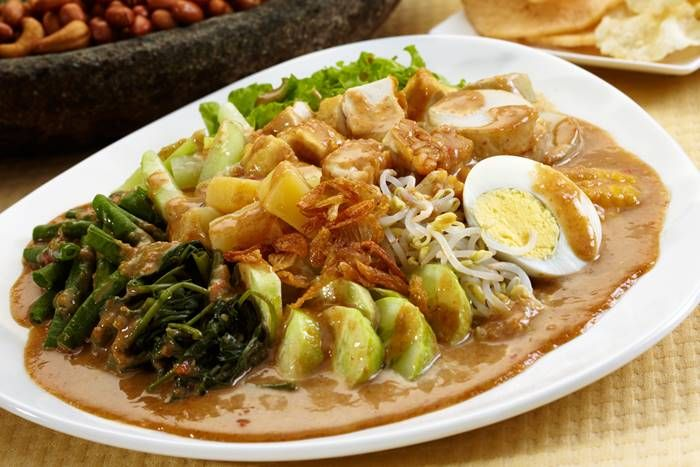

<html lang="en">
<head>
    <meta charset="UTF-8">
    <meta name="viewport" content="width=device-width, initial-scale=1.0">
    <title>Document</title>
    <link rel="stylesheet" href="style2.css">
    
</head>
<body>
    <nav class="navbar">
  <a href="#Gado-gado">Gado-Gado</a>
  <a href="#Resep">Resep</a>
  <a href="#Kontak">Kontak</a>
</nav>

    <h1>Mengenal makanan gado-gado</h1>

    

        

            
        

        

            <section id="Gado-gado">
            <h1 class="h1">Gado-gado</h1>
            
<b>Gado-gado adalah salah satu makanan khas Indonesia yang terkenal dengan kelezatannya. Makanan ini terdiri dari berbagai sayuran segar yang direbus atau dikukus, seperti kacang panjang, kol, tauge, dan kentang. Sayuran tersebut kemudian disiram dengan saus kacang yang gurih dan manis, serta ditambahkan dengan irisan telur rebus, tahu, tempe, dan kerupuk sebagai pelengkap.</b>

            
<b>Gado-gado memiliki cita rasa yang unik karena perpaduan antara sayuran segar dan saus kacang yang kaya akan rempah. Makanan ini tidak hanya lezat tetapi juga sehat karena mengandung banyak serat dan nutrisi dari sayuran. Gado-gado sering disajikan sebagai hidangan utama atau sebagai lauk pendamping dalam berbagai acara.</b>

            </section>
        

         <h2>Variasi di berbagai daerah</h2>
        

            <table>
                <thead>
                    <tr>
                        <th>Variasi</th>
                        <th>Ciri khas</th>
                    </tr>
                </thead>
                <tbody>
                    <tr>
                        <td>Gado-gado Betawi</td>
                        <td>Gaya Jakarta, bumbu kacang dibuat kental</td>
                    </tr>
                    <tr>
                        <td>Gado-gado Padang</td>
                        <td>Ditambah mi kuning dan soun, rasanya cenderung pedas</td>
                    </tr>
                    <tr>
                        <td>Gado-gado Sidoarjo</td>
                        <td>Bumbu kacang diberi petis</td>
                    </tr>
                    <tr>
                        <td>Karedok</td>
                        <td>Mirip gado-gado, tetapi sayurannya mentah</td>
                    </tr>
                </tbody>
            </table>
        

    

    <section id="Resep">
        <h2>Resep Gado-gado</h2>
        
<b>Bahan-bahan:</b>

        <ul>
            <li>200 gram kacang panjang, potong-potong</li>
            <li>200 gram kol, iris tipis</li>
            <li>100 gram tauge</li>
            <li>2 buah kentang, rebus dan potong dadu</li>
            <li>2 butir telur, rebus dan iris</li>
            <li>100 gram tahu, goreng dan potong dadu</li>
            <li>100 gram tempe, goreng dan potong dadu</li>
            <li>Kerupuk secukupnya</li>
        </ul>

        
<b>Bumbu Kacang:</b>

        <ul>
            <li>150 gram kacang tanah, sangrai dan haluskan</li>
            <li>3 siung bawang putih, haluskan</li>
            <li>2 buah cabai merah, haluskan (sesuai selera)</li>
            <li>1 sendok makan gula merah, serut</li>
            <li>1 sendok teh garam</li>
            <li>200 ml air hangat</li>
            <li>2 sendok makan air asam jawa</li>
        </ul>

        
<b>Cara membuat:</b>

        <ol>
            <li>Rebus sayuran (kacang panjang, kol, tauge) hingga matang. Tiriskan.</li>
            <li>Sajikan sayuran rebus di piring saji.</li>
            <li>Tambahkan kentang rebus, irisan telur, tahu goreng, dan tempe goreng di atas sayuran.</li>
            <li>Buat bumbu kacang dengan mencampurkan kacang tanah halus, bawang putih, cabai merah, gula merah, garam, air hangat, dan air asam jawa. Aduk rata hingga menjadi saus kental.</li>
            <li>Siram bumbu kacang di atas sayuran dan pelengkapnya.</li>
            <li>Sajikan gado-gado dengan kerupuk sebagai pelengkap.</li>
        </ol>

        </section>

    <section id="Kontak" class="kontak">
        <h2>Hubungi Kami</h2>
        
Ada pertanyaan atau mau pesan g  ado-gado? Hubungi kami:

        

            <a class="kontak-item" href="tel:+6288289930021">📞 088289930021</a>
            <a class="kontak-item wa" href="https://wa.me/6288289930021" target="_blank">💬 WhatsApp</a>
        

    </section>

    <footer class="footer">
        
🥗 <b>Resep Gado-Gado</b>

        
&copy; 2026 Kelompok PPLG X RPL 1. Semua hak dilindungi.

    </footer>
</body>
</html>
</body>
</html>
</body>
</html>
